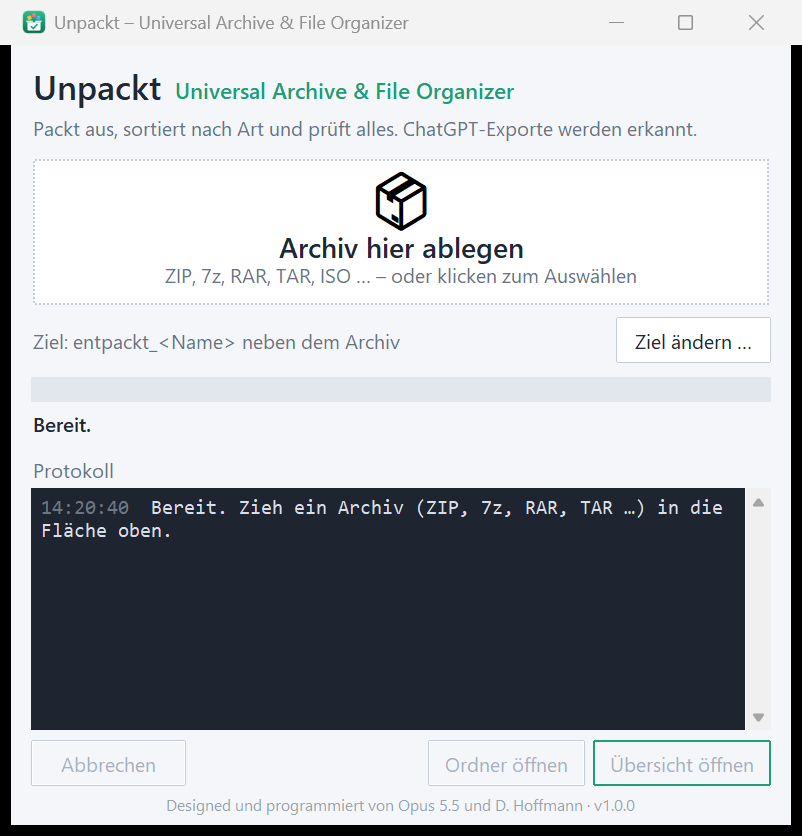

# Unpackt

**Universal Archive & File Organizer**

Unpacks archives, sorts every file by type and verifies everything.
ChatGPT data exports are detected automatically and turned into readable chats.



[English](#english) · [Deutsch](#deutsch)

---

## English

### What it does

Drop an archive (or a folder) into the window. Unpackt creates a new folder
`entpackt_<name>` next to it and sorts every file into a folder by type:
images to images, text to text, JSON to JSON, and so on.
Every single file is checked afterwards.

### Features

- **Drag & drop window** with progress bar and live log – or use the command line
- **Many formats**

  | Format | How |
  |---|---|
  | ZIP | read directly, no temporary copy |
  | TAR, TAR.GZ, TAR.BZ2, TAR.XZ, TAR.ZST | Python standard library |
  | Single compressed files (.gz, .bz2, .xz, .zst) | Python standard library |
  | 7z, RAR, ISO, CAB, … | `bsdtar` (built into Windows 10/11 as `tar.exe`) |

- **Sorting by type** into about 15 folders with around 200 known extensions.
  The folder names are German:

  | Folder | Examples |
  |---|---|
  | Bilder (images) | png, jpg, webp, gif, svg, heic, raw … |
  | Videos | mp4, mov, mkv, webm … |
  | Audio | mp3, wav, ogg, flac, m4a … |
  | Texte (text) | txt, md, rtf, log … |
  | Dokumente (documents) | pdf, docx, odt, epub … |
  | Tabellen (spreadsheets) | xlsx, csv, ods … |
  | Präsentationen (presentations) | pptx, odp, key … |
  | JSON | json, jsonl, geojson … |
  | Daten (data) | xml, yaml, sql, sqlite … |
  | Code | py, js, html, css, c, java, rs … |
  | Archive | zip, 7z, rar, iso … |
  | Schriften (fonts), 3D, E-Mails, Programme | ttf, stl, eml, exe … |
  | Sonstiges (other) | everything else |

  Files without an extension are recognised by their content (e.g. a PNG without `.png`).
  Duplicate names become `name (2).ext` – nothing is ever overwritten.
  System junk (`__MACOSX`, `Thumbs.db`, `.DS_Store`) is skipped.

- **Verification**
  1. SHA-256 of the whole archive **before** unpacking
  2. Work in sections of 2,000 files: sort in, then check every file
     (size, CRC32, SHA-256). A broken file is copied once more.
  3. SHA-256 of the archive **after** unpacking – it must be identical
  4. Results in `Zuordnung.csv` (every file with its SHA-256) and `SHA256.txt`

- **ChatGPT exports** are detected automatically. Files get their real names back
  (instead of `file_….dat`), and every chat is written as Markdown into `Chats/`
  with links to the sorted files.

- **Safe**: the archive is only read, never changed. The target folder must be new or empty.
  Paths that try to escape the target folder are refused.

- **One single file**, Python standard library only.

### Requirements

- Python 3.12 or newer (tested with Python 3.14 on Windows 11)
- Optional: [`tkinterdnd2`](https://pypi.org/project/tkinterdnd2/) for drag & drop.
  Without it you click the area and pick the archive.
- For 7z, RAR, ISO, CAB: `bsdtar`. Windows 10/11 and macOS already have it.
  On Linux install `libarchive-tools`.

### Installation

**Windows – without Python:** download **`Unpackt.exe`** from the
[Releases](../../releases) page and start it. You can also drop an archive onto the EXE.

**Windows – with Python:** double-click **`start.bat`**.
On the first start it creates a Python environment (`venv`) and installs drag & drop
by itself. You can also drop an archive straight onto `start.bat`.

**By hand:**

```
pip install -r requirements.txt      # optional, only for drag & drop
```

That's it – everything is in `unpackt.py`.

### Usage

**Window** (no arguments):

```
python unpackt.py              # Windows without a console window: pythonw unpackt.py
python unpackt.py --gui export.zip
```

**Command line**:

```
python unpackt.py export.zip                 # result: entpackt_export next to the archive
python unpackt.py export.7z D:\Sorted\Export # own target folder
```

| Option | Meaning |
|---|---|
| `--abschnitt N` | files per section before checking (default 2000) |
| `--probe` | dry run: only count, write nothing (ZIP or folder) |
| `--hardlink` | hard links instead of copies (folder source, same drive) |
| `--gui` | open the window |
| `--version` | show the version |

### Result

```
entpackt_export/
├─ Bilder/  Videos/  Audio/  Texte/  Dokumente/  JSON/  Code/  …
├─ Chats/            only for ChatGPT exports
├─ Übersicht.md      overview of all folders (and chats)
├─ Zuordnung.csv     every file: source, target, type, check result, SHA-256
├─ SHA256.txt        SHA-256 of the archive before and after
└─ Protokoll.txt     the full log
```

### About the EXE

`Unpackt.exe` is built from exactly the `unpackt.py` in this repository (with PyInstaller).
It is signed with a **self-signed certificate** (`CN=Unpackt`) – not with a certificate
from a paid certificate authority. That is why Windows will probably show
**"Unknown publisher"** or a SmartScreen warning on your PC, and some virus scanners
may report a false alarm (common for PyInstaller programs).

The whole source code is open – **you decide yourself** whether you want to use the EXE:

- Check the download: compare its SHA-256 with `Unpackt.exe.sha256` from the release
  (`Get-FileHash Unpackt.exe -Algorithm SHA256` in PowerShell).
- Or skip the EXE and use `start.bat` / `python unpackt.py` – then you run exactly the code you can read here.
- Or build the EXE yourself (see below).

### Build the EXE yourself

```
python -m venv .venv-build
.venv-build\Scripts\pip install pyinstaller tkinterdnd2
.venv-build\Scripts\pyinstaller --onefile --windowed --name Unpackt --icon assets\unpackt.ico ^
  --add-data "assets\unpackt.ico;assets" --add-data "assets\unpackt.png;assets" unpackt.py
```

The EXE is then in `dist\`.

### Limitations

- Password-protected archives are not supported yet.
- Archives inside the archive are not unpacked; they go to `Archive/`.
- RAR is handled by `bsdtar` but has not been tested with real RAR files yet.
- The program itself speaks German for now. English is planned.

### License

MIT – see [LICENSE](LICENSE).

Designed and programmed by Opus 5.5 and D. Hoffmann.

---

## Deutsch

### Was es macht

Ein Archiv (oder einen Ordner) ins Fenster ziehen. Unpackt legt daneben einen neuen Ordner
`entpackt_<Name>` an und sortiert jede Datei nach Art in einen Ordner:
Bilder zu Bildern, Texte zu Texten, JSON zu JSON und so weiter.
Danach wird jede einzelne Datei geprüft.

### Funktionen

- **Fenster mit Ziehen & Ablegen**, Ladebalken und Protokoll – oder die Kommandozeile
- **Viele Formate**

  | Format | Wie |
  |---|---|
  | ZIP | direkt gelesen, ohne Zwischenkopie |
  | TAR, TAR.GZ, TAR.BZ2, TAR.XZ, TAR.ZST | Python-Standardbibliothek |
  | Einzelne gepackte Dateien (.gz, .bz2, .xz, .zst) | Python-Standardbibliothek |
  | 7z, RAR, ISO, CAB, … | `bsdtar` (in Windows 10/11 als `tar.exe` eingebaut) |

- **Sortierung nach Art** in rund 15 Ordner mit etwa 200 bekannten Endungen:
  Bilder, Videos, Audio, Texte, Dokumente, Tabellen, Präsentationen, JSON, Daten, Code,
  Archive, Schriften, 3D, E-Mails, Programme und Sonstiges.
  Dateien ohne Endung werden am Inhalt erkannt (z. B. ein PNG ohne `.png`).
  Doppelte Namen werden zu `Name (2).ext` – es wird nie etwas überschrieben.
  System-Müll (`__MACOSX`, `Thumbs.db`, `.DS_Store`) wird übersprungen.

- **Prüfung**
  1. SHA-256 des ganzen Archivs **vorher**
  2. Arbeit in Abschnitten zu 2.000 Dateien: einsortieren, dann jede Datei prüfen
     (Größe, CRC32, SHA-256). Eine kaputte Datei wird noch einmal kopiert.
  3. SHA-256 des Archivs **nachher** – muss gleich sein
  4. Ergebnisse in `Zuordnung.csv` (jede Datei mit SHA-256) und `SHA256.txt`

- **ChatGPT-Exporte** werden automatisch erkannt. Die Dateien bekommen ihre echten Namen zurück
  (statt `file_….dat`), und jeder Chat landet als Markdown in `Chats/`,
  mit Links zu den sortierten Dateien.

- **Sicher**: Das Archiv wird nur gelesen, nie verändert. Der Ziel-Ordner muss neu oder leer sein.
  Pfade, die aus dem Ziel-Ordner ausbrechen wollen, werden abgelehnt.

- **Eine einzige Datei**, nur Python-Standardbibliothek.

### Voraussetzungen

- Python 3.12 oder neuer (getestet mit Python 3.14 unter Windows 11)
- Optional: [`tkinterdnd2`](https://pypi.org/project/tkinterdnd2/) für Ziehen & Ablegen.
  Ohne das Paket klickt man auf die Fläche und wählt das Archiv aus.
- Für 7z, RAR, ISO, CAB: `bsdtar`. Windows 10/11 und macOS haben es schon.
  Unter Linux das Paket `libarchive-tools` installieren.

### Installation

**Windows – ohne Python:** **`Unpackt.exe`** unter [Releases](../../releases)
herunterladen und starten. Man kann ein Archiv auch direkt auf die EXE ziehen.

**Windows – mit Python:** Doppelklick auf **`start.bat`**.
Beim ersten Start legt sie selbst eine Python-Umgebung (`venv`) an und richtet
Ziehen & Ablegen ein. Man kann ein Archiv auch direkt auf `start.bat` ziehen.

**Von Hand:**

```
pip install -r requirements.txt      # optional, nur für Ziehen & Ablegen
```

Fertig – alles steckt in `unpackt.py`.

### Benutzung

**Fenster** (ohne Angaben):

```
python unpackt.py              # Windows ohne Konsolenfenster: pythonw unpackt.py
python unpackt.py --gui export.zip
```

**Kommandozeile**:

```
python unpackt.py export.zip                  # Ergebnis: entpackt_export neben dem Archiv
python unpackt.py export.7z D:\Sortiert\Export # eigener Ziel-Ordner
```

| Option | Bedeutung |
|---|---|
| `--abschnitt N` | Dateien pro Abschnitt vor der Prüfung (Standard 2000) |
| `--probe` | Probelauf: nur zählen, nichts schreiben (ZIP oder Ordner) |
| `--hardlink` | harte Links statt Kopien (Ordner als Quelle, gleiches Laufwerk) |
| `--gui` | Fenster öffnen |
| `--version` | Version anzeigen |

### Ergebnis

```
entpackt_export/
├─ Bilder/  Videos/  Audio/  Texte/  Dokumente/  JSON/  Code/  …
├─ Chats/            nur bei ChatGPT-Exporten
├─ Übersicht.md      Übersicht aller Ordner (und Chats)
├─ Zuordnung.csv     jede Datei: Quelle, Ziel, Art, Prüfergebnis, SHA-256
├─ SHA256.txt        SHA-256 des Archivs vorher und nachher
└─ Protokoll.txt     das ganze Protokoll
```

### Zur EXE

`Unpackt.exe` wird aus genau der `unpackt.py` in diesem Repository gebaut (mit PyInstaller).
Sie ist mit einem **selbst erstellten Zertifikat** (`CN=Unpackt`) signiert – nicht mit einem
gekauften Zertifikat einer Zertifizierungsstelle. Deshalb zeigt Windows auf deinem PC
wahrscheinlich **„Unbekannter Herausgeber“** oder eine SmartScreen-Warnung, und manche
Virenscanner schlagen eventuell fälschlich Alarm (bei PyInstaller-Programmen häufig).

Der ganze Quellcode ist offen – **du entscheidest selbst**, ob du die EXE nutzen willst:

- Download prüfen: SHA-256 mit `Unpackt.exe.sha256` aus dem Release vergleichen
  (`Get-FileHash Unpackt.exe -Algorithm SHA256` in PowerShell).
- Oder die EXE weglassen und `start.bat` / `python unpackt.py` nehmen – dann läuft genau der Code, den du hier lesen kannst.
- Oder die EXE selbst bauen (siehe unten).

### Die EXE selbst bauen

```
python -m venv .venv-build
.venv-build\Scripts\pip install pyinstaller tkinterdnd2
.venv-build\Scripts\pyinstaller --onefile --windowed --name Unpackt --icon assets\unpackt.ico ^
  --add-data "assets\unpackt.ico;assets" --add-data "assets\unpackt.png;assets" unpackt.py
```

Die EXE liegt danach in `dist\`.

### Grenzen

- Archive mit Passwort gehen noch nicht.
- Archive im Archiv werden nicht weiter ausgepackt; sie landen in `Archive/`.
- RAR läuft über `bsdtar`, wurde aber noch nicht mit echten RAR-Dateien getestet.
- Das Programm selbst spricht vorerst Deutsch. Englisch ist geplant.

### Lizenz

MIT – siehe [LICENSE](LICENSE).

Designed und programmiert von Opus 5.5 und D. Hoffmann.
